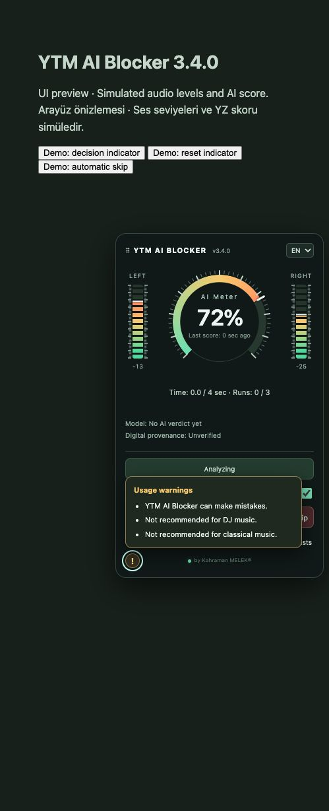

# YTM AI Blocker v3.4.0

[TR — Türkçe](README.tr.md)

Experimental local audio scoring and personal track skipping for YouTube Music, by Kahraman MELEK®.

**YTM AI Blocker can make mistakes. Not recommended for DJ music or classical music.** Genuine recordings may be incorrectly flagged; AI-generated recordings may be missed. Scores are model estimates, not calibrated probabilities or proof of origin.

## Install and start (macOS)

Requires Chrome/Chromium 116+, Python 3.10+, an internet connection for initial setup, and a local Python helper running while using audio analysis.

1. Download this repository using **Code → Download ZIP**, extract it, and open `Install.command` (or `Kurulum.command`) once. Setup installs dependencies and downloads the model separately.
2. Open `Start.command` (or `Başlat.command`) and keep its window open. The service listens only at `127.0.0.1:5050`.
3. Open `chrome://extensions`, enable **Developer mode**, choose **Load unpacked**, and select the `extension` folder.
4. Open YouTube Music and click the extension's toolbar icon to grant/start tab audio capture. Initial capture requires this Chrome action.
5. Use the panel to pause/resume AI analysis. The audio connection and stereo meters stay active while analysis is paused. Click the toolbar icon again to end capture.

After an update, reload the extension, refresh YouTube Music, and restart capture. Restart the local helper when server files change. The local helper and unpacked extension must come from the same release.

## Behavior

- The panel opens at the right edge, vertically centered. Drag its header or use arrow keys while the header is focused. **Lists → Reset position** returns it to the right-center position.
- TR/EN language selection, integer percentages, a green–yellow–red **AI Meter**, scale ticks and a decaying peak marker.
- Independent left/right RMS level meters in dBFS, with ticks, decaying peak markers and a gradient from green at 10% of the display scale to red at 90%+. These are VU-style digital meters, not calibrated broadcast VU instruments.
- Four-second mono model windows advance every second. Stereo channels are kept separate for the level meters.
- AI timing verdict: score **strictly above 80% for four continuous seconds**, OR **three separate runs of at least three seconds each** within the same track. A single run counts once. A score at/below 80% ends the current run; completed runs remain until evidence is reset by track/seek/pause, missing/invalid samples or restarting analysis.
- **Auto-skip on:** a fresh qualifying model verdict skips the track. **Auto-skip off:** analysis, meters and the displayed verdict continue without a model-triggered skip. Allowed tracks are not automatically skipped.
- Block individual tracks, allow them, and manage entries in **Lists**. Model-triggered skips do not permanently block tracks.
- **Automatically skipped** lists up to 200 local entries with track title, time, reason and the most recent score. It records a next-button click followed by observed track change; failed/unavailable next controls do not create history entries. Records can be removed individually.
- The bottom-left **!** opens warnings on hover, focus or click. Escape/outside click dismisses the bubble.
- Click **by Kahraman MELEK®** to open a GitHub suggestion form. Submission is manual, public, and requires a GitHub account.

## Provenance and privacy

The live **Production label** reads available text declarations/provider mentions such as Suno or Udio. **None** does not mean human-made. **Digital provenance: Unverified** is intentional: live C2PA/SynthID verification is not integrated. Tab-captured PCM does not carry the original file's C2PA metadata.

Live audio is processed in memory and sent only to the local helper. The extension does not save captured audio or upload listening data. Preferences, track blocks/allowances and skip history remain in local Chrome storage. Setup downloads packages/model files; those providers do not receive live listening data. Clicking a feedback or track link opens the chosen website.

Optional developer tools: `tools/read_c2pa.py` reads/extracts manifests from explicitly supplied local files. Install its separate pinned requirements with `python -m pip install -r tools/requirements-c2pa.txt`. It is not part of live auto-skip. Remote manifest and OCSP fetching are disabled; use `--trust-anchors` with an independently obtained local C2PA trust list. Manifest presence, trusted signatures, and AI assertions are distinct results.

## Validation and limitations

Run `npm test` and `python -m unittest discover -s tests -p 'test_*.py'` after installing NumPy. `python tools/build_release.py` builds source/extension archives without models, environments, private audio, analysis reports or local settings. Preview screenshots use simulated input and are not detection accuracy results.

The local helper derives a zero-denominator guard for two HPSS divisions in the pinned ArtifactNet graph. Original graph/weights are preserved. This fixes a reproduced numerical failure; it does **not** establish classification accuracy. See [known limitations](docs/KNOWN-LIMITATIONS.md).

The model is separately licensed **CC BY-NC 4.0** with additional owner notices. It is downloaded during setup and is not included here. See [third-party notices](THIRD_PARTY_NOTICES.md). No Chrome Web Store publication is claimed.
