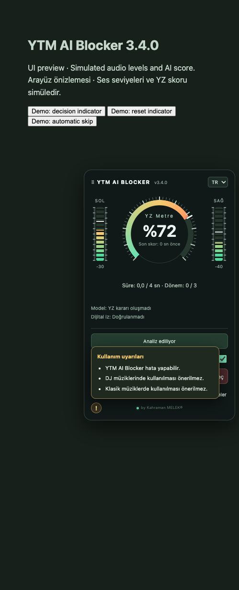

# YTM AI Blocker v3.4.0

[EN — English](README.md)

YouTube Music için deneysel yerel ses skoru ve kişisel parça geçişi. by Kahraman MELEK®.

**YTM AI Blocker hata yapabilir. DJ müziklerinde ve klasik müziklerde kullanılması önerilmez.** Özgün kayıtları YZ olarak işaretleyebilir; YZ kayıtlarını kaçırabilir. Skor, kalibre edilmiş olasılık veya üretim kanıtı değildir.

## Kurulum ve başlatma (macOS)

Chrome/Chromium 116+, Python 3.10+, ilk kurulum için internet bağlantısı ve analiz boyunca açık kalacak yerel Python yardımcısı gerekir.

1. GitHub’da **Code → Download ZIP** ile indirin, arşivi açın ve `Kurulum.command` veya `Install.command` dosyasını bir kez çalıştırın. Bağımlılıklar ve model ayrıca indirilir.
2. `Başlat.command` veya `Start.command` dosyasını açıp penceresini açık tutun. Sunucu yalnızca `127.0.0.1:5050` adresinde çalışır.
3. `chrome://extensions` ekranında **Geliştirici modu**nu açın, **Paketlenmemiş öğe yükle** ile `extension` klasörünü seçin.
4. YouTube Music’i açıp Chrome araç çubuğundaki eklenti simgesine tıklayın. İlk ses yakalama Chrome’un bu kullanıcı işlemini gerektirir.
5. Panelden YZ analizini durdurup devam ettirin. Analiz dururken ses bağlantısı ve VU metreler çalışır. Yakalamayı tamamen bitirmek için eklenti simgesine tekrar tıklayın.

Güncellemede eklentiyi yeniden yükleyin, YouTube Music’i yenileyin ve yakalamayı yeniden başlatın. Sunucu dosyaları değiştiyse yerel yardımcıyı da yeniden başlatın. Eklenti ve yardımcı aynı sürümden olmalıdır.

## Çalışma biçimi

- Panel başlangıçta sağ kenarda, dikey ortada açılır. Başlığından sürüklenebilir; başlık odaktayken ok tuşlarıyla taşınabilir. **Listeler → Konumu sıfırla** sağ-orta konumuna döndürür.
- TR/EN seçimi, tam sayı yüzdeler, yeşil–sarı–kırmızı **YZ Metre**, çentikler ve yavaş azalan tepe işareti bulunur.
- Sağ/sol ses gücü dBFS olarak ayrı ölçülür. VU metrelerde çentikler ve tepe çizgileri vardır; gösterge ölçeğinde %10 yeşil, %90 ve üzeri kırmızıdır. Bunlar yayın standardına göre kalibre edilmiş VU cihazları değildir.
- Model dört saniyelik mono pencereleri her saniye değerlendirir. VU metreler için stereo kanallar ayrı tutulur.
- Karar: skorun **kesintisiz dört saniye %80 üzerinde** kalması VEYA aynı parçada **üç ayrı yükselişin her birinin en az üç saniye %80 üzerinde** kalması. Tek yükseliş bir kez sayılır. %80 ve altı mevcut yükselişi bitirir; tamamlanan dönemler parça/arama/duraklatma, eksik/geçersiz örnek veya analizi yeniden başlatmayla sıfırlanana kadar korunur.
- **Otomatik atla açık:** güncel koşulu sağlayan model kararı parçayı geçirir. **Kapalı:** analiz, metre ve karar gösterimi sürer; model otomatik geçiş yaptırmaz. İzin verilen parçalar otomatik geçilmez.
- Parçalar tek tek engellenebilir veya izin verilebilir; kayıtlar **Listeler**den yönetilir. Modelin geçirdiği parçalar kendiliğinden kalıcı engellenmez.
- **Otomatik geçilenler**, son 200 yerel kaydı parça adı, zaman, neden ve son skorla gösterir. Sonraki düğmesine tıklanıp parça değişimi görüldüğünde kayıt oluşur; kullanılamayan düğme kayıt oluşturmaz. Kayıtlar tek tek silinebilir.
- Sol alttaki **!** simgesi üzerine gelince, odaklanınca veya tıklanınca uyarıları açar. Escape veya dışarı tıklamayla kapanır.
- **by Kahraman MELEK®** GitHub öneri formunu açar. Gönderim kullanıcı tarafından yapılır; herkese açıktır ve GitHub hesabı gerektirir.

## Üretim bilgisi ve gizlilik

Canlı **Üretim etiketi**, mevcut açıklamalardaki Suno/Udio gibi isimleri ve üretim beyanlarını okur. **Yok**, insan üretimi demek değildir. **Dijital iz: Doğrulanmadı** bilerek gösterilir: canlı C2PA/SynthID doğrulaması bağlı değildir. Sekmeden yakalanan PCM, özgün dosyanın C2PA metaverisini taşımaz.

Canlı ses bellekte işlenir ve yalnızca yerel yardımcıya gönderilir. Eklenti yakalanan sesi diske kaydetmez veya dinleme verisini dışarı yüklemez. Tercihler, engeller, izinler ve geçiş geçmişi Chrome’un yerel deposunda kalır. Kurulum model/bağımlılık indirir; bu sağlayıcılara canlı ses gönderilmez. Öneri veya parça bağlantısı seçilen web sitesini açar.

İsteğe bağlı geliştirici aracı `tools/read_c2pa.py`, açıkça verilen yerel dosyaların manifestini okur/çıkarır. Ayrı bağımlılığı `python -m pip install -r tools/requirements-c2pa.txt` ile kurulabilir. Canlı otomatik geçişe bağlı değildir. Uzak manifest ve OCSP sorguları kapalıdır; `--trust-anchors` için bağımsız olarak edinilmiş yerel C2PA güven listesi kullanılmalıdır. Manifest bulunması, güvenilir imza ve YZ üretim beyanı ayrı sonuçlardır.

## Doğrulama ve sınırlar

NumPy kurulduktan sonra `npm test` ve `python -m unittest discover -s tests -p 'test_*.py'` çalıştırılabilir. `python tools/build_release.py`, model/ortam/özel ses/analiz raporu/kişisel ayar içermeyen kaynak ve eklenti paketleri üretir. Görseller simüle önizlemedir; doğruluk sonucu değildir.

Yardımcı, sabit ArtifactNet grafiğindeki iki HPSS bölmesi için sıfır payda koruması içeren ayrı yerel kopya üretir. Özgün grafik ve ağırlıklar korunur. Tekrarlanan sayısal hata düzeltilmiştir; bu, sınıflandırma doğruluğunun kanıtı değildir. [Bilinen sınırlar](docs/KNOWN-LIMITATIONS.md).

Model ayrıca **CC BY-NC 4.0** lisansı ve sahibinin ek bildirimlerine tabidir. Kurulumda indirilir; depoya dahil değildir. [Üçüncü taraf bildirimleri](THIRD_PARTY_NOTICES.md). Chrome Web Store’da yayımlandığı iddia edilmez.
